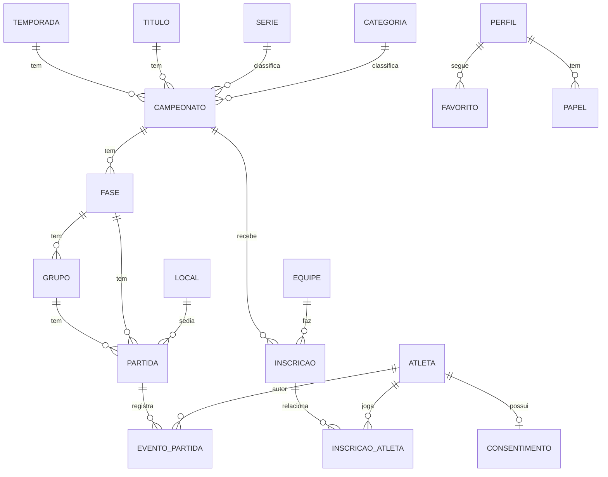

# Modelo de dados e mapa de páginas — LOFS

## Entidades (Postgres / Supabase)

| Tabela | Campos principais | Leitura pública | Escrita |
|---|---|---|---|
| temporada, titulo, serie, categoria | nome, slug, ordem | sim | admin |
| campeonato | titulo, temporada, serie, categoria, regras de pontuação/desempate (jsonb), status (rascunho/publicado/encerrado) | só publicados | admin |
| fase | campeonato, tipo (grupos/mata-mata), ida_volta, ordem | se campeonato publicado | admin |
| grupo | fase, nome | idem | admin |
| equipe | nome, slug, bairro, cores, escudo | sim | admin |
| inscricao | campeonato, equipe, grupo | idem | admin |
| atleta | nome esportivo, nome completo, ano de nascimento, foto_path | visão pública filtrada por consentimento | admin |
| atleta_privado | documento, data de nascimento, contato do responsável | **nunca** | admin |
| consentimento | atleta, responsável, termo_versao, data, revogado_em | não | admin |
| inscricao_atleta | inscricao, atleta, numero | idem | admin |
| local | nome, endereço, bairro | sim | admin |
| partida | fase, grupo, mandante, visitante, local, data_hora, status (agendada/ao vivo/encerrada/WO), placar, pênaltis, mesario_id | se publicado | admin; mesário só a sua |
| evento_partida | partida, tipo (gol/gol contra/amarelo/vermelho/pênalti), atleta, equipe, minuto/período | idem | admin; mesário da partida |
| perfil, papel | user_id, nome; papel (admin/mesário) | só o próprio | admin |
| favorito | user_id, campeonato/equipe | só o próprio | o próprio |
| importacao | url, status, json extraído, revisado_por | não | admin |
| auditoria | quem, ação, tabela, quando | não | trigger |

**Derivados (views/funções):** `classificacao` (por grupo, com desempate), `artilharia`, `disciplina`, `ranking`, `perfil_atleta_publico`.

## Mapa de páginas

**Público**
- `/` — jogos de hoje/ao vivo, próximos jogos, destaques da rodada, atalho para campeonatos favoritos.
- `/campeonatos` — filtro Temporada → Título → Série → Categoria.
- `/campeonatos/[slug]` — abas: Classificação · Jogos · Artilharia · Cartões · Equipes · Chaveamento (mata-mata).
- `/jogos` — calendário por data; `/jogos/[id]` — súmula: placar, gols, cartões, local.
- `/equipes`, `/equipes/[slug]` — elenco, campeonatos, últimos jogos.
- `/atletas/[slug]` — perfil (respeitando consentimento), gols e cartões.
- `/ranking` — por grupo de categoria e série.
- `/locais/[slug]` — ginásio e jogos agendados.
- `/entrar`, `/minha-conta` — link mágico e favoritos.
- `/sobre` — a liga e o aviso de projeto acadêmico.

**Painel (`/painel`)**
- Campeonatos (fases, grupos, inscrições, geração de tabela), Equipes, Atletas (consentimento), Locais, Partidas (agenda e atribuição de mesário), Súmula (lançamento de gols/cartões e encerramento), Importação (Firecrawl), Usuários e papéis, Auditoria.
